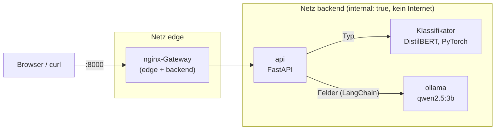

# Lokaler MVZ-Posteingangs-Router

Ein Medizinisches Versorgungszentrum bekommt täglich Patientenmails. Dieser Router ordnet jede Mail
einem von sechs Typen zu (`termin`, `rezept`, `ueberweisung`, `befund`, `au`, `sonstiges`) und
extrahiert die relevanten Felder. **Alles läuft lokal**: Die Container, die Mails verarbeiten (api, ollama), haben zur Laufzeit keinen Internetzugang; nur ein nginx-Gateway reicht Port 8000 durch,
keine Mail verlässt die Maschine. Es werden ausschließlich synthetische Daten verwendet
(Adressen nur `*.example`).

Das Repo ist ein Demo-Projekt. Der Bauprozess mit KI-Agenten ist mindestens so wichtig wie die
Software: siehe [So wurde das gebaut](#so-wurde-das-gebaut).

## Architektur



- **Typ:** `distilbert/distilbert-base-german-cased`, feinabgestimmt auf 6 Klassen. Gewichte werden nicht
  committet, `make setup` trainiert sie (Details: [docs/training.md](docs/training.md)).
- **Felder:** LangChain-Kette mit `ChatOllama` und strukturierter Ausgabe auf ein Pydantic-Schema.
- **Netz:** `api` und `ollama` hängen nur im `internal: true`-Netz. Nur der nginx-Gateway ist zusätzlich
  im `edge`-Netz und veröffentlicht Port 8000, gebunden nur an `127.0.0.1` (nicht im LAN erreichbar, da der Endpunkt keine Authentifizierung hat). Das Gateway hängt in beiden Netzen (edge und backend).
- **Vertrag:** `POST /route` mit `{sender, subject, body}` liefert `{type, confidence, fields}`;
  `GET /health`. Genaue Definition in der [Spec](docs/superpowers/specs/2026-10-25-mail-router-design.md).

## Quickstart

Voraussetzungen: Docker Desktop (**RAM auf 8 GB** stellen), [uv](https://docs.astral.sh/uv/), `make`.

```bash
make setup   # einmalig, braucht Internet; ca. 10-20 min
make up      # startet gateway, api, ollama
```

Dann `http://localhost:8000` öffnen (Testseite) oder:

```bash
curl -s localhost:8000/route -H 'content-type: application/json' \
  -d '{"sender":"max@praxis-patient.example","subject":"Termin","body":"Ich brauche nächste Woche einen Termin."}'
```

Der Port ist nur an `127.0.0.1` gebunden. Zusätzliche Befehle: `make test` (pytest), `make egress-check`, `make down`.

Tests: `make test` bzw. `uv run pytest` führt die schnelle Suite aus; `uv run pytest -m slow` braucht trainierte Gewichte in `models/classifier`.

`make setup` lädt das Basismodell, erzeugt die Trainingsdaten, trainiert den Klassifikator
(ca. 1 min auf Apple-GPU/MPS, auf der CPU länger), lädt `qwen2.5:3b` (ca. 2 GB) und baut das api-Image
(ca. 1,2 GB). Die Dauer hängt stark von der Bandbreite ab.

**Gemessen:** Median 1,5 s pro `/route`-Aufruf über die 60 Holdout-Mails (warmes Modell, CPU im Docker-Container, 8 GB RAM); der erste Aufruf nach dem Start ist langsamer (Modellladen). Ein einzelner Aufruf während des Builds lag bei ca. 4 s.

**Kein Internet zur Laufzeit, prüfbar:** `make egress-check` versucht, aus `api` und `ollama` nach außen zu
verbinden, und meldet `EGRESS BLOCKED`, wenn alles scheitert.

## So wurde das gebaut

Der vollständige Verlauf steht im [Build-Log](docs/build-log.md). Ziel war ein nachvollziehbarer Agenten-Prozess mit unabhängiger Prüfung. Die orchestrierende Sitzung lief
auf Claude Opus, die ausführenden Builder- und Reviewer-Subagents auf Claude Sonnet. Verwendet wurden die
Superpowers-Skills (`brainstorming`, `writing-plans`, `subagent-driven-development`) in Claude Code.

1. **Brainstorming und Spec.** Intent, Ziele, Anti-Ziele, Constraints und der API-Vertrag stehen in der
   [Design-Spec](docs/superpowers/specs/2026-10-25-mail-router-design.md), bevor Code existiert.
2. **Reviewer-Check der Spec.** Ein separater Reviewer prüfte die Spec auf Lücken und Widersprüche, bevor sie
   freigegeben wurde.
3. **Holdout vor dem Code.** Der Orchestrator schrieb 60 Szenarien (ca. 10 je Typ, inkl. schwieriger Fälle)
   und ein `eval.py` von Hand, außerhalb des Repos. Der Zugriff für bauende Agenten ist
   über Deny-Regeln in [`.claude/settings.json`](.claude/settings.json) gesperrt (Read, Edit und Bash auf den
   Pfad; Best Effort, keine Sandbox), und die Prompts erwähnen den Holdout nie. [`CLAUDE.md`](CLAUDE.md)
   verbietet Suchen und Nachbauen. Die Hashes in [`holdout.sha256`](holdout.sha256) wurden **vor dem ersten
   Code-Commit** committed. So lässt sich später belegen, dass der Holdout danach nicht verändert wurde.
4. **Plan.** Die Spec wurde in 7 kleine Tasks zerlegt: [Implementierungsplan](docs/superpowers/plans/2026-10-25-mail-router.md).
5. **Ein Subagent pro Task, mit Review.** Jeder Task wurde von einem frischen Builder-Agenten umgesetzt
   (ein Commit pro Task) und von einem Reviewer geprüft. Der Review fand echte Fehler, die als eigene
   `fix:`-Commits sichtbar sind:
   - Label-Leck: Betreff im Generator verriet den Typ.
   - Typ-Reihenfolge wich von der Spec ab (jetzt mit Literal-Sync-Test).
   - Ungültige Kalenderdaten (31.02.) wurden als Geburtsdatum akzeptiert.
   - pytest fand das Paket auf macOS nicht (versteckte `.pth`-Datei).
6. **Unabhängige Abnahme.** Nach dem Build führte der Repo-Eigentümer den Holdout gegen den laufenden
   Docker-Stack aus. Die Sperre galt auch für den Orchestrator. Danach kamen `holdout/` und
   `docs/abnahme.md` ins Repo, und die Hashes wurden geprüft (beide OK).

**Beleg:** `git log --oneline` zeigt das Muster `feat:` pro Task, bei Bedarf gefolgt von `fix:` nach dem Review.

**Abnahme: bestanden.** Typ-Accuracy 0,933 (Schwelle 0,85), Feld-Trefferquote 0,964 (Schwelle 0,70),
Median-Latenz 1,5 s, ohne Nachbesserungsrunde. Details und Fehlfälle stehen in [docs/abnahme.md](docs/abnahme.md).

## Einschränkungen

- **Nur synthetische Daten.** Der Klassifikator erreicht auf den eigenen Validierungsdaten Accuracy 1.0. Das zeigt
  nur, dass die synthetischen Daten leicht sind, nicht dass der Router in der Praxis so gut ist. Aussagekräftig
  ist allein der unabhängige Holdout (siehe Abnahme).
- **CPU-Latenz.** Median 1,5 s pro Mail bei warmem Modell (Holdout, 60 Mails), deutlich mehr beim ersten Aufruf nach dem Start. Kein GPU-Zugriff in Docker Desktop.
- **Kleines Sprachmodell.** `qwen2.5:3b` extrahiert Felder unzuverlässiger als große Modelle.
- **Kein Medizinprodukt.** Kein Einsatz mit echten Patientendaten, keine Mail-Anbindung, keine Benutzerverwaltung,
  keine Persistenz, kein Sicherheits- oder Datenschutz-Audit.
